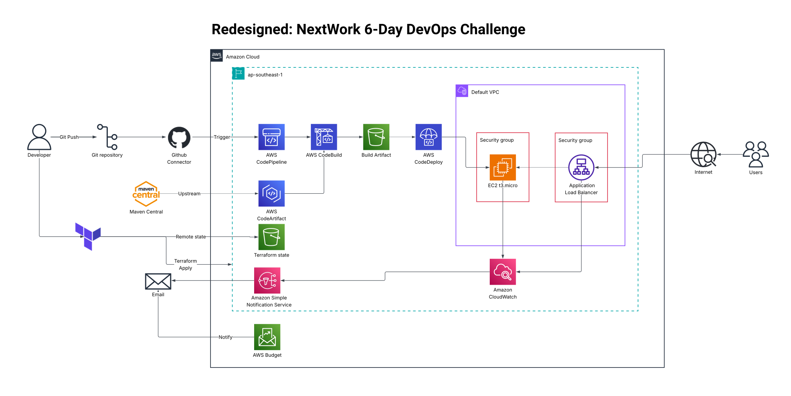

# nextwork-ops

Terraform for a NextWork 6-Day DevOps Challenge project on AWS (`ap-southeast-1`):
a CodePipeline CI/CD flow that builds a Maven webapp and deploys it to a Tomcat EC2 instance,
fronted by an ALB with alarms and a cost budget. This replaces the original CloudFormation stack.

Part of my portfolio: **[cedscode.vercel.app](https://cedscode.vercel.app/)**

> ## Disclaimer
> Personal learning and portfolio project, built while completing NextWork's 6-Day DevOps
> Challenge. **Not production-ready:** single instance, no autoscaling, HTTP only (no TLS).
> **It costs real money** (the ALB is roughly US$16-20/month); run `terraform destroy` when idle.
> It targets the default VPC of one region. Provided as-is, with no warranty - review
> `terraform plan` before applying to your own account. Not affiliated with NextWork or AWS.

## Architecture


## Secret missions completed
Both NextWork secret missions were completed in the original CloudFormation-based build of this project:
- **Automated testing (CodeBuild):** added a test step (`test.sh`) to the build so tests run automatically on every build.
- **Manual rollback (CodePipeline):** triggered a manual rollback of the Deploy stage and verified the web app reverted to its previous state.

The Terraform here supports both: the pipeline is V2 (required for stage rollback), and the CodeDeploy
deployment group auto-rolls back failed deployments. The test script lives in the app repo,
[`CedsCode/nextwork-web-project`](https://github.com/CedsCode/nextwork-web-project).

## What it creates
| Module | Resources |
|---|---|
| `artifacts` | S3 artifact bucket (SSE-S3, public access blocked) |
| `codeartifact` | CodeArtifact domain + repo, Maven Central upstream |
| `security_groups` | ALB SG; app SG (app port from the ALB only, optional direct/SSH CIDRs) |
| `web_server` | EC2 (AL2023, Tomcat 9 + Corretto 8 + CodeDeploy agent), SSM role, tag `role=webserver` |
| `codebuild` | Build project (source = CodePipeline), role, 30-day log group |
| `codedeploy` | Server app + in-place deployment group (tag `role=webserver`), service role |
| `pipeline` | GitHub connection (CodeStar) + V2 pipeline: Source -> Build -> Deploy, role |
| `alb` | ALB, target group (health check `/nextwork-web-project/`), HTTP:80 listener |
| `monitoring` | SNS topic + email, alarms: StatusCheckFailed, UnHealthyHostCount, ALB 5XX |
| `budget` | Monthly budget filtered by the `Project` tag, alerts at 50/80/100% |
| `network` | Lookup only: default VPC and subnets |

Tags on everything via `default_tags`: Project, Environment, Owner, ManagedBy.
Access to the instance is **SSM Session Manager only** unless you set `ssh_cidr`.

## Layout
```
bootstrap/    one-off config: creates the S3 bucket for remote state (local state)
main.tf       wires the modules together
variables.tf  every tunable value
modules/      one folder per row in the table above
```

## First-time setup
1. **Bootstrap remote state** (once):
   ```bash
   cd bootstrap
   terraform init && terraform apply
   terraform output -raw backend_hcl > ../backend.hcl
   cd ..
   ```
2. **Configure**: copy `terraform.tfvars.example` to `terraform.tfvars`, set `alert_email`.
   To test the app directly before the ALB, add your IP: `app_direct_cidrs = ["x.x.x.x/32"]`.
3. **Activate the cost-allocation tag**: Billing console -> Cost allocation tags -> activate
   `Project`. Can take ~24h; only the budget's tag filter depends on it.
4. **Plan and apply**:
   ```bash
   terraform init -backend-config=backend.hcl
   terraform fmt -check && terraform validate
   terraform plan -out=tfplan      # review, then:
   terraform apply tfplan
   ```
5. **Authorize the GitHub connection** (manual, once): Developer Tools -> Settings ->
   Connections -> the `nextwork-github` connection -> *Update pending connection*. Until you do,
   the pipeline's Source stage fails. Then release a change in the pipeline.
6. **Confirm the SNS email** AWS sends, or no alerts are delivered.

The app repo needs `appspec.yml` at its root (copy `target/nextwork-web-project.war` to
`/opt/tomcat/webapps`) and a `buildspec.yml` whose `artifacts:` block lists `appspec.yml` and
`target/*.war`.

## Verify
- Direct: `terraform output web_server_url` (needs `app_direct_cidrs`).
- Via ALB: `terraform output alb_url`.
- If a deployment fails with `HEALTH_CONSTRAINTS`, check that `appspec.yml` is in the build
  artifact, then `/opt/codedeploy-agent/deployment-root/` logs on the instance.

## Cleanup
```bash
terraform plan -destroy -out=destroy.tfplan   # review first
terraform apply destroy.tfplan
```
The state bucket in `bootstrap/` is protected by `prevent_destroy`; delete it by hand only
after the main config is gone.
